# Model Radar — AI Model Tracker

**English** · [ภาษาไทย](README.th.md)

Model Radar collects data on the AI models of five vendors **every day**, keeps the full history, and compares
them in a bilingual (Thai / English) Streamlit dashboard: quality, price, value for money, speed, usage,
lifecycle (releases and shutdowns), and what developers are saying.

**Vendors tracked:** OpenAI (GPT) · Anthropic (Claude) · Google (Gemini) · DeepSeek · xAI (Grok)

The AI model market changes every week: new models, price cuts, retirements. Vendor pages show only the
current state, so nobody keeps a clean, queryable history. Model Radar builds that history and answers:

1. Which model gives the best quality per dollar right now, and how has that changed?
2. How are prices and usage shifting between vendors over time?
3. Which models are new, deprecated or about to be shut down?
4. What are developers saying about each vendor, and which aspects (coding, pricing, speed …) are praised or criticised?
5. Did sentiment or usage change after a model release?

---

## Who it is for

- **Developers and tech teams** choosing a model for a task and budget, or planning a migration before a shutdown date.
- **Managers** comparing cost and value across vendors.
- **Data / ML engineers** looking for an end-to-end example: a multi-source daily pipeline, a raw landing zone,
  a modelled warehouse with SQL metrics, data-quality checks, applied NLP with an evaluation loop, and a dashboard.

---

## Features

### Dashboard (Streamlit, read-only)

| Page | What you get |
|---|---|
| **Overview** | KPI cards (highest quality, best value, cheapest top-tier model, next official shutdown) with a one-line explanation each; top-10 quality and value charts; each vendor's flagship side by side; what changed in the last 30 days. Animated radar logo and the five brand icons in the header. |
| **Price & value** | Quality vs price scatter (every model labelled, zoomable); value ranking; **"weigh it your way"** sliders for quality / price / speed with a rank-stability chart; full lineup with standard, batch and cache prices; price history. Standard vs Batch pricing switch with an explanation. |
| **Usage** | Vendor share of tokens on OpenRouter with a **period switch**: full history since January 2025 (weekly) or only what the daily pipeline collected; an automatic plain-language **summary** (leader per year, biggest gainer and loser, each vendor's peak) and a quarterly table; what "other models" contains; task-type shares. |
| **News & sentiment** | Developer sentiment per vendor (30 days, with change vs the previous 30), an aspect heatmap (praise vs criticism by topic), a weekly trend with release markers, positive-vs-negative by aspect, example comments with links; news coverage per week and a searchable news feed (Hacker News, vendor blogs, press). |
| **Model lifecycle** | Upcoming official shutdowns with recommended replacements and days left; a one-year-back / one-year-ahead timeline; models added to or removed from OpenRouter. |
| **Pipeline health** | A Databricks-style run matrix (every run, every task, colour-coded), run list with first issue, task-level detail, data-quality results, freshness per source, missed days, and an **inventory of all data in the system** by source and store. |

Every number is tagged with its provenance — **Official** (vendor), **Third-party** (OpenRouter / Artificial
Analysis) or **Derived** (calculated here) — and a metric glossary is one click away. The whole UI switches
between **Thai and English** (`?lang=EN` in the URL opens English).

### Labelling tool

A separate Streamlit app in `labeler/` is used to hand-label a fixed sample of 300 Hacker News comments
(sentiment, intent, aspects). The labels are the evaluation set for the sentiment model. It writes a local CSV
only and never touches the databases, so the dashboard stays read-only.

### Pipeline

- Runs daily at **10:00 Asia/Bangkok** via n8n, with an **hourly catch-up until 22:00** if the machine was off at 10:00
  (the worker skips if today's full run already finished).
- One n8n node per task, so a failure is visible per task and never blocks the others.
- **Catch-up windows:** after missed days, Hacker News, GDELT and usage rankings automatically reach back to the
  last successful load.
- **Raw first:** every API response is stored unchanged in MongoDB before it is transformed, so any day can be reprocessed.
- **Idempotent:** every write is an upsert on natural keys; re-running a day never duplicates.
- **Data-quality checks** after every run (key validity, model-count drop, >50 % price moves, duplicates, parse
  failures, unmapped benchmarks, sentiment model evaluated, failed tasks); a failed check marks the n8n execution red.

---

## Screenshots

| | |
|---|---|
| **Overview** — KPI cards, top-10 quality and value, brand header | **Each vendor's flagship & what changed** |
| 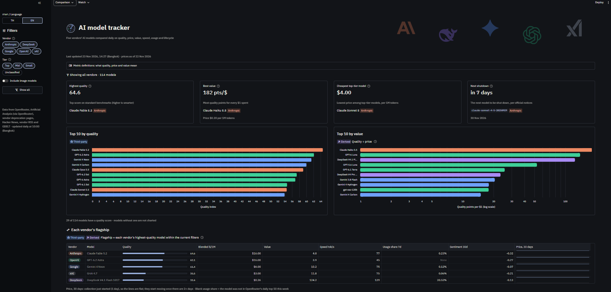 | 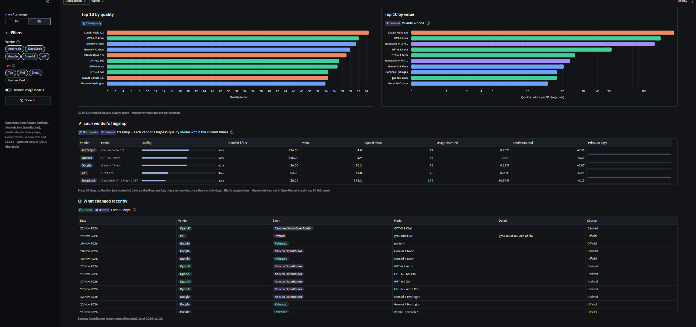 |
| **Price & value** — quality vs price, value ranking, weights | **Rank stability, full lineup, price history** |
| 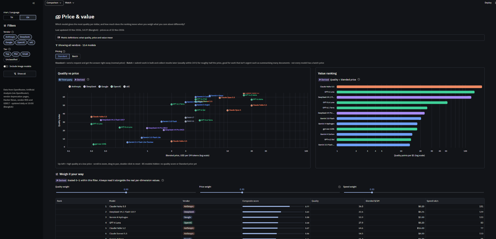 | 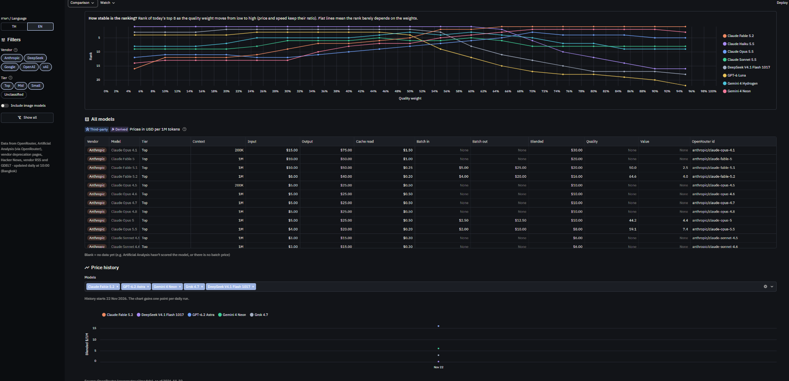 |
| **Usage** — automatic summary and quarterly table (since Jan 2025) | **Usage** — period switch: since the pipeline started |
| 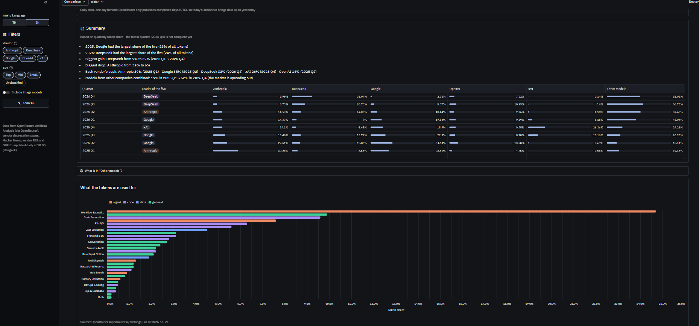 | 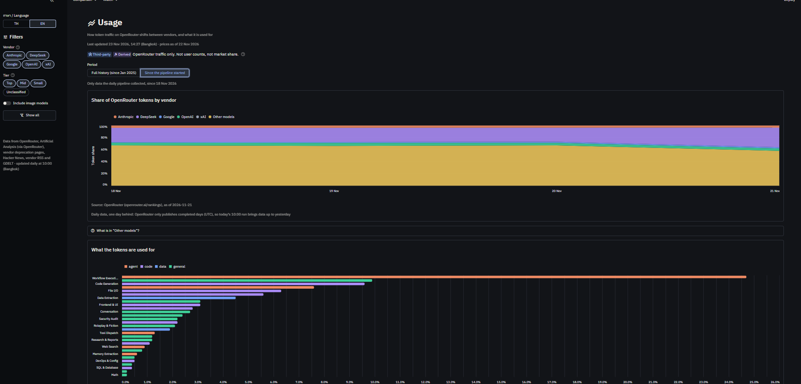 |
| **News & sentiment** — vendor scores, aspect heatmap, example comments | **Model lifecycle** — upcoming shutdowns |
| 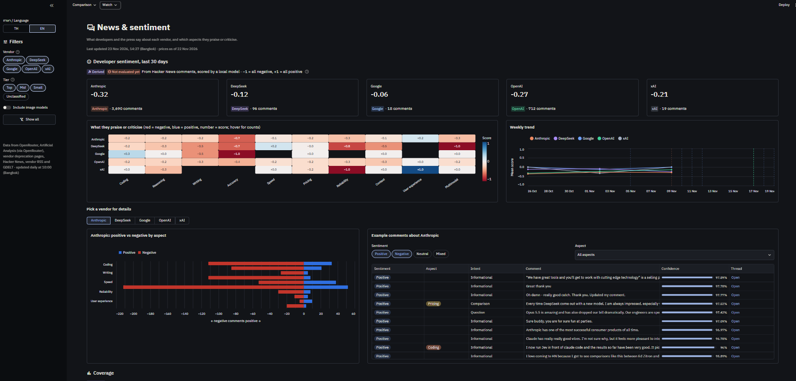 | 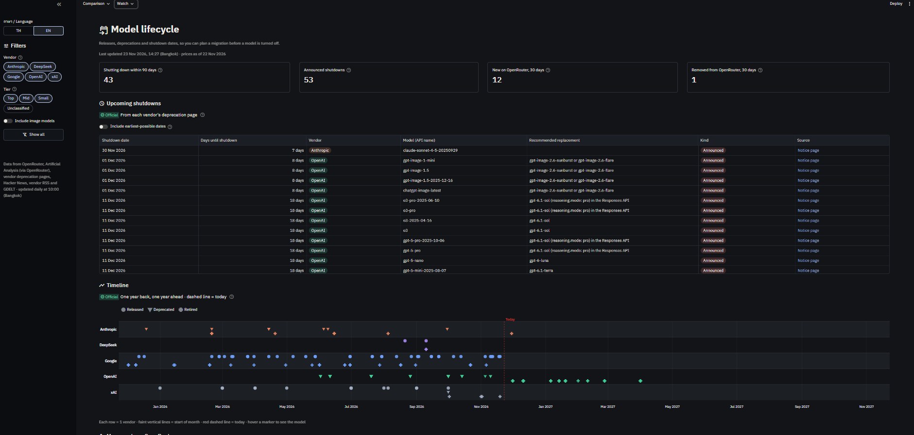 |
| **Lifecycle timeline** and OpenRouter movements | **Pipeline health** — Databricks-style run matrix |
| 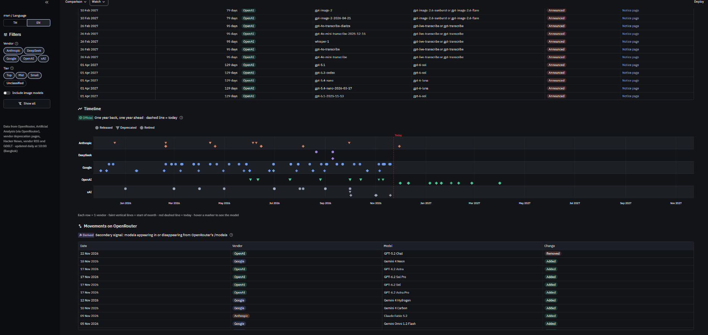 | 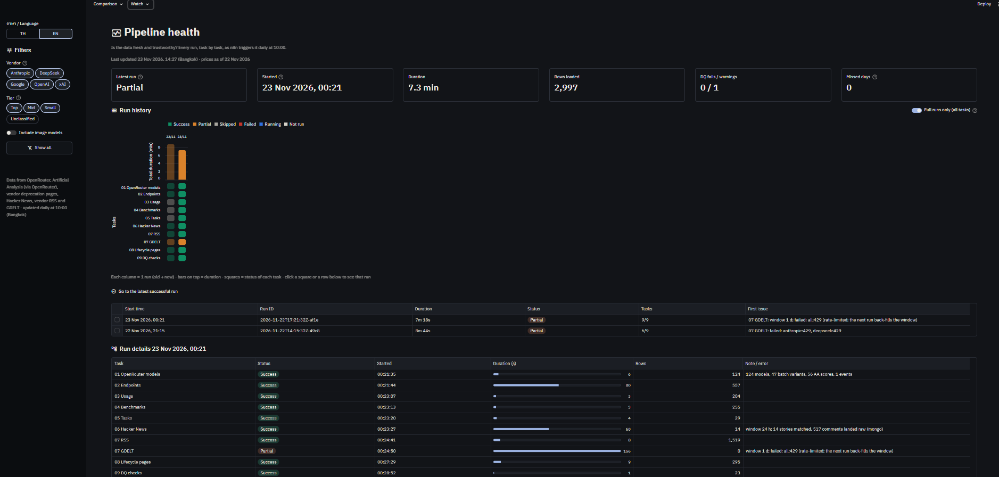 |
| **All data in the system** — by source and store | **n8n** — the daily `00_master` workflow |
| 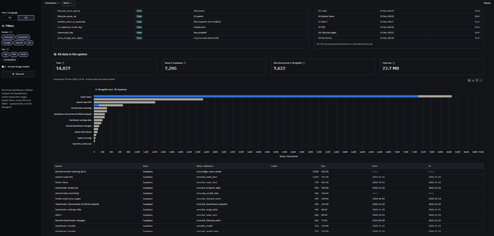 | 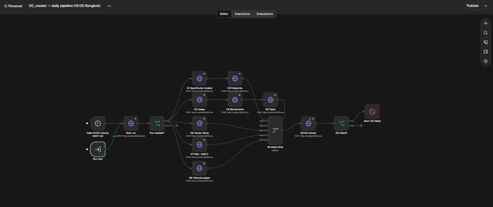 |

---

## Architecture

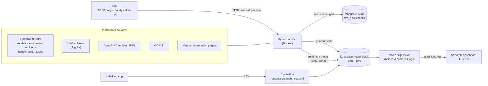

### Daily workflow in n8n

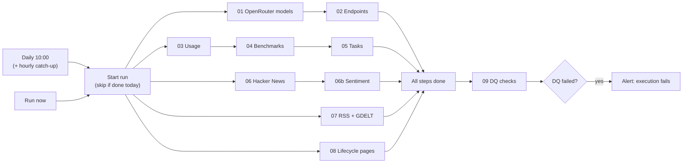

---

## Tech stack

| Layer | Technology |
|---|---|
| Orchestration | **n8n** (self-hosted, Docker) — schedule, one node per task, retries, alert on DQ failure |
| Ingestion & ML jobs | **Python 3.12** worker container (requests, psycopg2, pymongo, **PyTorch CPU + Hugging Face transformers**) behind a small HTTP trigger |
| Raw landing zone | **MongoDB Atlas** (free M0) |
| Modelled storage | **Supabase PostgreSQL** — `core` (facts and dimensions), `ops` (run log, DQ, inventory), `mart` (views the dashboard reads) |
| Dashboard | **Streamlit** + **Altair** (Vega-Lite), read-only database role, Thai/English UI |
| Design | Theme in `.streamlit/config.toml` (ink-and-paper palette, IBM Plex Sans Thai), vendor colours shared by charts and badges |

---

## Data sources

All sources are free. No paid model calls are ever made: the project only **reads** public data.

| Source | Endpoint | Used for |
|---|---|---|
| **OpenRouter** `/models` | `GET https://openrouter.ai/api/v1/models` | model catalogue, context length, modalities, prices (incl. batch and cache), Artificial Analysis scores embedded per model |
| **OpenRouter** `/endpoints` | `GET /api/v1/models/{author}/{slug}/endpoints` | per-provider prices, uptime, latency and throughput (p50–p99) |
| **OpenRouter** rankings-daily | `GET /api/v1/datasets/rankings-daily` | daily top-50 models by tokens + an "other" row; history back to 2025-01-01 |
| **OpenRouter** `/benchmarks` | `GET /api/v1/benchmarks` | Artificial Analysis Intelligence / coding / agentic indices |
| **OpenRouter** task classifications | `GET /api/v1/classifications/task?window=7d` | share of tokens by task type |
| **Hacker News** (Algolia) | `GET https://hn.algolia.com/api/v1/search` | stories and comments that mention the vendors |
| **OpenAI news RSS** · **Google DeepMind blog RSS** | `openai.com/news/rss.xml`, `deepmind.google/blog/rss.xml` | vendor announcements |
| **GDELT DOC 2.0** | `GET https://api.gdeltproject.org/api/v2/doc/doc` | press coverage (one combined query per run) |
| **Vendor deprecation pages** | Anthropic, OpenAI, Google (Gemini API), DeepSeek change log, xAI release notes | official release, deprecation and shutdown dates |
| **Hugging Face model** | `cardiffnlp/twitter-roberta-base-sentiment-latest` | sentiment model, runs locally on CPU |

Attribution: usage and model data — *Source: OpenRouter (openrouter.ai)*; quality scores — *Artificial Analysis,
via OpenRouter*. Brand icons in the header are from [Lobe Icons](https://github.com/lobehub/lobe-icons) (MIT); the
marks remain trademarks of their owners.

---

## How the numbers are calculated

| Metric | Logic |
|---|---|
| **Reference price** | The vendor's own standard endpoint on OpenRouter (e.g. `OpenAI [openai]`, not `/flex` or `/fast` variants) → else the median across providers → else OpenRouter's headline price. Never the cheapest host: it is often a quantised build, and dividing a full-model quality score by its price inflates value. |
| **Blended price** | `(3 × input + 1 × output) ÷ 4` USD per 1M tokens on the reference price (typical work sends about 3× more input than output). |
| **Quality** | Artificial Analysis Intelligence Index (composite of standard benchmarks: knowledge, reasoning, maths, coding, instruction following). Capability only, not speed or price. |
| **Value** | `quality ÷ blended price` = quality points per $1. Heavy-tailed (cheap small models score very high), so charts use a log scale. |
| **Speed** | Median across providers of p50 throughput (tokens/s) and p50 latency (ms). |
| **Composite score** | `w_q·norm(quality) + w_p·norm(1/price) + w_s·norm(speed)`, min-max scaled within the current filter, weights set by the user; always shown next to the real values. |
| **Usage share** | A vendor's tokens ÷ all tokens that day on OpenRouter (incl. "other"). OpenRouter traffic only: not users, not market share. Retired models are attributed to their vendor by OpenRouter prefix. |
| **Price change** | A change in the vendor's own endpoint price vs its previous snapshot. If days were missed, the event says the change happened "between date A and date B". |
| **Lifecycle** | Official vendor pages are primary; "first seen" / "removed from OpenRouter" are secondary, derived signals. "Not sooner than" / "earliest possible" dates are kept but flagged as tentative. |
| **Sentiment** (model `v0.1`) | RoBERTa sentiment on each comment and on each clause that mentions an aspect (clauses split at *but / however / although*), so "great code, but too expensive" gives coding = positive and pricing = negative; overall = *mixed* when both appear. Aspects (10) by keyword lexicon, intent (comparison, recommendation, complaint, question, informational) by rules. A comment counts for a vendor only if it names the vendor, or sits in a story about a single vendor. |
| **Vendor matching for news** | A vendor keyword **and** a context term (e.g. "Gemini" + Google/AI/LLM), because "Gemini", "Claude" and "GPT" are ambiguous words. |

Evaluation: the sentiment model is scored against the hand-labelled set (`scripts/eval_sentiment.py` →
`reports/sentiment_eval.md`, precision / recall / F1 per class and per aspect). Until that report exists, the dashboard
marks sentiment as **not evaluated yet**.

---

## Snapshot — 23 November 2026

*From the data collected so far (first pipeline run 22 Nov 2026; usage history back to 1 Jan 2025).*

**Market and models**
- **114** active text models tracked across the five vendors (OpenAI 58 · Google 20 · Anthropic 16 · DeepSeek 14 · xAI 6); 29 have an Artificial Analysis quality score.
- **Highest quality:** Claude Fable 5.2 (64.6) · GPT-6.2 Astra (62.1) · Gemini 4 Neon (61.4).
- **Best value:** Claude Haiku 5.5 (182 points per $, $0.20 / 1M tokens) · GPT-6 Luna (140) · DeepSeek V4.1 Flash 1017 (124).
- **Cheapest top-tier model:** Claude Sonnet 5 at $4.00 / 1M tokens (blended).
- **Fastest (median p50 throughput):** Grok 4.20 Multi-Agent (553 tok/s) · gpt-oss-safeguard-20b (402) · Gemini 2.5 Flash Lite (201).

**Lifecycle**
- **43** model IDs have an official shutdown date within the next 90 days; the next one is `claude-sonnet-4-5-20250929` on **30 Nov 2026**.
- 295 official lifecycle events parsed from the five vendor pages, plus 126 derived OpenRouter events.

**Usage on OpenRouter (Jan 2025 → Nov 2026)**
- 2025 leader among the five: **Google** (23 % of all tokens); 2026 leader: **DeepSeek** (24 %).
- Biggest gain: **DeepSeek**, 9 % → 32 % (2025 Q1 → 2026 Q4). Biggest drop: **Anthropic**, 39 % → 6 %.
- Peaks: Anthropic 39 % (2025 Q1) · Google 35 % (2025 Q2) · DeepSeek 32 % (2026 Q4) · xAI 26 % (2025 Q4) · OpenAI 14 % (2025 Q2).
- Models from other companies combined grew from 19 % to 52 %: the market is spreading out (Tencent alone held about 42 % of tokens in the latest week).

**News and sentiment**
- 2,463 news items collected (Hacker News 778 · OpenAI news 1,419 · DeepMind blog 100 · GDELT 166).
- **7,317** Hacker News comments scored with sentiment model `v0.1` (25 Oct – 22 Nov 2026). Mean polarity (−1 to +1):
  Google −0.08 (26 comments) · DeepSeek −0.13 (116) · xAI −0.19 (27) · OpenAI −0.26 (807) · Anthropic −0.33 (6,345).
- Most criticised aspect: Anthropic **accuracy** (−0.64, 225 mentions), then OpenAI accuracy (−0.41) and Anthropic reliability (−0.33).
  The only positive aspects: Anthropic **user experience** (+0.11) and DeepSeek **pricing** (+0.06).
- Read these with care: the model is **not evaluated yet**, HN comments lean critical overall, and Anthropic and OpenAI
  account for 98 % of the comments, so the scores for Google, DeepSeek and xAI rest on few data points.

**Data held**
- About **57,700** modelled rows in PostgreSQL (incl. 35,088 daily usage rows) and **7,600+** raw documents (~20 MB) in MongoDB.

---

## Running it

### Prerequisites
Docker Desktop, Python 3.11+, a MongoDB Atlas M0 cluster, a Supabase project, and a free OpenRouter API key.

```bash
cp .env.example .env                       # fill in your own values (never commit .env)
python -m venv .venv && .venv/Scripts/activate      # Windows; use bin/activate on macOS/Linux
pip install -r worker/requirements.txt -r app/requirements.txt

python scripts/migrate.py                  # create schemas, tables, views; load seeds
python scripts/test_keys.py                # check every source and connection
python scripts/backfill_usage.py           # optional: usage history since 2025-01-01

docker build -f worker/Dockerfile -t ai-model-tracker-worker:local .
docker compose up -d                       # n8n (http://localhost:5678) + worker
docker compose exec n8n n8n import:workflow --input=/workflows/00_master.json
#   then open n8n, open 00_master and activate it

python scripts/make_app_secrets.py         # dashboard credentials (read-only role) from .env
cd app && streamlit run streamlit_app.py   # dashboard
```

Labelling and evaluation:

```bash
python scripts/export_label_sample.py      # draw the 300-comment sample (once)
cd labeler && streamlit run labeler_app.py # labelling tool
python scripts/eval_sentiment.py           # evaluate → reports/sentiment_eval.md
```

---

## Repository layout

```
├── app/                   Streamlit dashboard (read-only): streamlit_app.py, app_pages/, lib/, static/brands/
├── labeler/               Streamlit labelling tool (writes data/labels/ only)
├── worker/                Python worker: run_daily.py, server.py (HTTP trigger for n8n), jobs/, tracker/
├── n8n/workflows/         00_master.json (exported, no credentials)
├── supabase/migrations/   001–014 numbered SQL migrations (schemas, tables, mart views)
├── mongodb/               init_indexes.js
├── seed/                  dim_vendor.csv, model_tiers.csv
├── scripts/               migrate, test_keys, backfill_usage, export_label_sample, eval_sentiment, …
├── data/labels/           evaluation sample and hand labels
├── CLAUDE.md              project rules, data model and metric definitions (source of truth)
└── progress.md            build status
```

---

## Limitations

- **Snapshots start on 22 Nov 2026.** Prices, quality and lifecycle state are only available "as of now" from the
  APIs, so their history grows one day at a time; only usage could be backfilled.
- **Usage is OpenRouter traffic only**, not each vendor's total usage.
- **Quality scores** exist only for models Artificial Analysis has tested (29 of 114 today).
- **Sentiment is not evaluated yet** and leans on Hacker News, where Anthropic and OpenAI are discussed far more
  than Google or xAI, so scores for the smaller vendors rest on few comments.
- **GDELT** rate-limits by IP; when it does, the next run back-fills the missed window.
