# Model Radar — AI Model Tracker

[English](README.md) · **ภาษาไทย**

Model Radar เก็บข้อมูลโมเดล AI ของ 5 ผู้ให้บริการ **ทุกวัน** เก็บประวัติไว้ทั้งหมด และเปรียบเทียบกันใน
dashboard Streamlit สองภาษา (ไทย / อังกฤษ): คุณภาพ ราคา ความคุ้มค่า ความเร็ว การใช้งาน
วงจรชีวิตโมเดล (เปิดตัวและปิดใช้งาน) และความเห็นของนักพัฒนา

**ผู้ให้บริการที่ติดตาม:** OpenAI (GPT) · Anthropic (Claude) · Google (Gemini) · DeepSeek · xAI (Grok)

ตลาดโมเดล AI เปลี่ยนทุกสัปดาห์ มีโมเดลใหม่ ลดราคา และปิดโมเดลเก่า แต่หน้าเว็บของผู้ให้บริการแสดงแค่สถานะปัจจุบัน
จึงไม่มีใครเก็บประวัติแบบที่ค้นย้อนหลังได้ Model Radar สร้างประวัตินั้นขึ้นมาเพื่อตอบคำถาม:

1. ตอนนี้โมเดลไหนให้คุณภาพต่อเงิน 1 ดอลลาร์ดีที่สุด และเปลี่ยนไปอย่างไร
2. ราคาและการใช้งานของแต่ละผู้ให้บริการเปลี่ยนไปอย่างไรตามเวลา
3. โมเดลไหนใหม่ เลิกสนับสนุนแล้ว หรือใกล้ถูกปิด
4. นักพัฒนาพูดถึงแต่ละผู้ให้บริการว่าอย่างไร ด้านไหน (โค้ด ราคา ความเร็ว …) ถูกชมหรือถูกติ
5. ความเห็นหรือการใช้งานเปลี่ยนไปหลังเปิดตัวโมเดลใหม่หรือไม่

---

## เหมาะกับใคร

- **นักพัฒนาและทีมเทคนิค** ที่ต้องเลือกโมเดลให้เหมาะกับงานและงบ หรือวางแผนย้ายโมเดลก่อนวันปิดใช้งาน
- **ผู้บริหาร** ที่ต้องเทียบต้นทุนและความคุ้มค่าระหว่างผู้ให้บริการ
- **Data / ML engineer** ที่อยากดูตัวอย่างงานครบวงจร: pipeline รายวันจากหลายแหล่ง, raw landing zone,
  warehouse ที่คำนวณ metric ด้วย SQL, การตรวจคุณภาพข้อมูล, NLP พร้อมขั้นตอนประเมินผล และ dashboard

---

## ฟีเจอร์

### Dashboard (Streamlit, อ่านอย่างเดียว)

| หน้า | มีอะไรบ้าง |
|---|---|
| **ภาพรวม** | การ์ด KPI (คุณภาพสูงสุด, คุ้มค่าที่สุด, รุ่นท็อปที่ถูกที่สุด, วันปิดใช้งานที่ใกล้ที่สุด) พร้อมคำอธิบายสั้นๆ; กราฟ 10 อันดับคุณภาพและความคุ้มค่า; เทียบรุ่นเรือธงของแต่ละเจ้า; อะไรเปลี่ยนไปใน 30 วัน โลโก้เรดาร์แบบเคลื่อนไหวและไอคอน 5 แบรนด์ที่หัวหน้า |
| **ราคาและความคุ้มค่า** | กราฟคุณภาพเทียบราคา (ทุกจุดมีชื่อโมเดล ซูมได้); อันดับความคุ้มค่า; **ปรับน้ำหนักเอง** คุณภาพ / ราคา / ความเร็ว พร้อมกราฟความนิ่งของอันดับ; รายการโมเดลทั้งหมดพร้อมราคาปกติ, batch และ cache; ประวัติราคา สลับราคา Standard / Batch ได้พร้อมคำอธิบาย |
| **การใช้งาน** | ส่วนแบ่ง tokens บน OpenRouter ของแต่ละเจ้า **สลับช่วงเวลาได้**: ทั้งหมดตั้งแต่ ม.ค. 2025 (รายสัปดาห์) หรือเฉพาะช่วงที่ pipeline เก็บเอง; **สรุปเป็นภาษาคน** อัตโนมัติ (ผู้นำแต่ละปี, โตมาก/ลดมากที่สุด, จุดสูงสุดของแต่ละเจ้า) และตารางรายไตรมาส; "โมเดลอื่นๆ" มีอะไรบ้าง; สัดส่วนตามประเภทงาน |
| **ข่าวและความเห็น** | คะแนนความเห็นของนักพัฒนาต่อแต่ละเจ้า (30 วัน เทียบกับ 30 วันก่อนหน้า), heatmap ตามหัวข้อ (ชม vs ติ), แนวโน้มรายสัปดาห์พร้อมจุดเปิดตัวโมเดล, บวก vs ลบตามหัวข้อ, ตัวอย่างความเห็นพร้อมลิงก์; จำนวนข่าวรายสัปดาห์และรายการข่าวค้นหาได้ (Hacker News, บล็อกผู้ให้บริการ, สื่อ) |
| **วงจรชีวิตโมเดล** | โมเดลที่จะถูกปิดใช้งานตามประกาศทางการ พร้อมรุ่นที่แนะนำให้ย้ายไปและจำนวนวันที่เหลือ; ไทม์ไลน์ย้อนหลัง 1 ปี / ล่วงหน้า 1 ปี; โมเดลที่เพิ่มหรือหายไปจาก OpenRouter |
| **สถานะ pipeline** | ตารางการรันแบบ Databricks (ทุกรอบ ทุกงาน แยกสี), รายการรอบพร้อมปัญหาแรกที่เจอ, รายละเอียดรายงาน, ผลตรวจคุณภาพข้อมูล, ความสดของแต่ละแหล่ง, วันที่ขาด และ **ข้อมูลทั้งหมดในระบบ** แยกตามแหล่งและที่เก็บ |

ทุกตัวเลขมีป้ายบอกที่มา — **ทางการ** (ผู้ให้บริการ), **บุคคลที่สาม** (OpenRouter / Artificial Analysis)
หรือ **คำนวณเอง** — และมีคำอธิบายศัพท์ทุก metric ทั้งหน้าจอสลับ **ไทย / อังกฤษ** ได้ (ใส่ `?lang=EN` ใน URL เพื่อเปิดภาษาอังกฤษ)

### แอปติดป้ายข้อมูล

มีแอป Streamlit แยกต่างหากใน `labeler/` สำหรับติดป้ายความเห็น Hacker News 300 รายการด้วยมือ
(ความรู้สึก, เจตนา, หัวข้อ) ใช้เป็นชุดข้อมูลประเมินโมเดลวิเคราะห์ความเห็น แอปนี้เขียนแค่ไฟล์ CSV ในเครื่อง
ไม่แตะฐานข้อมูลเลย dashboard จึงยังเป็นแบบอ่านอย่างเดียว

### Pipeline

- รันทุกวัน **10:00 น. เวลาไทย** ผ่าน n8n และ **ลองรันซ้ำทุกชั่วโมงจนถึง 22:00** ถ้าตอน 10:00 เครื่องปิดอยู่
  (worker จะข้ามถ้าวันนี้รันครบแล้ว)
- หนึ่ง node ใน n8n ต่อหนึ่งงาน เห็นได้ทันทีว่างานไหนพัง และงานที่พังไม่ขวางงานอื่น
- **ตามเก็บย้อนหลัง:** ถ้าขาดไปหลายวัน Hacker News, GDELT และ usage rankings จะดึงย้อนไปถึงรอบล่าสุดที่สำเร็จเอง
- **เก็บ raw ก่อน:** ทุก response จาก API เก็บใน MongoDB แบบไม่แก้ไขก่อนแปลงข้อมูล จึงประมวลผลวันไหนใหม่ก็ได้
- **Idempotent:** ทุกการเขียนเป็น upsert ตาม natural key รันวันเดิมซ้ำก็ไม่เกิดข้อมูลซ้ำ
- **ตรวจคุณภาพข้อมูล** หลังทุกรอบ (key ใช้ได้ไหม, จำนวนโมเดลลดฮวบ, ราคาเปลี่ยนเกิน 50 %, ข้อมูลซ้ำ,
  parse หน้าไม่ได้, benchmark ที่จับคู่ไม่ได้, โมเดลความเห็นถูกประเมินแล้วหรือยัง, งานที่ล้มเหลว) ถ้าไม่ผ่านจะขึ้นแดงใน n8n

---

## ภาพหน้าจอ

| | |
|---|---|
| **ภาพรวม** — การ์ด KPI, 10 อันดับคุณภาพและความคุ้มค่า, หัวหน้าพร้อมโลโก้ | **รุ่นเรือธงของแต่ละเจ้า และอะไรเปลี่ยนไป** |
| 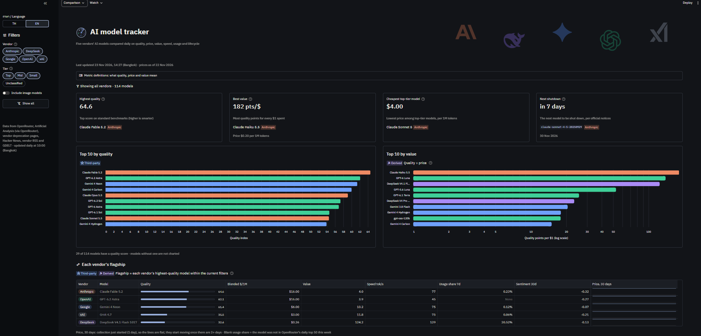 | 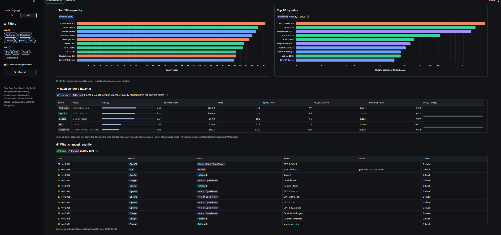 |
| **ราคาและความคุ้มค่า** — คุณภาพเทียบราคา, อันดับ, ปรับน้ำหนัก | **ความนิ่งของอันดับ, รายการโมเดล, ประวัติราคา** |
| 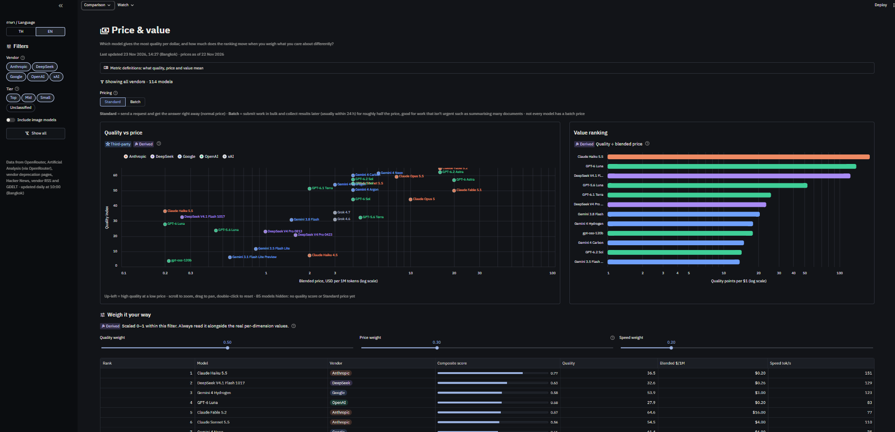 | 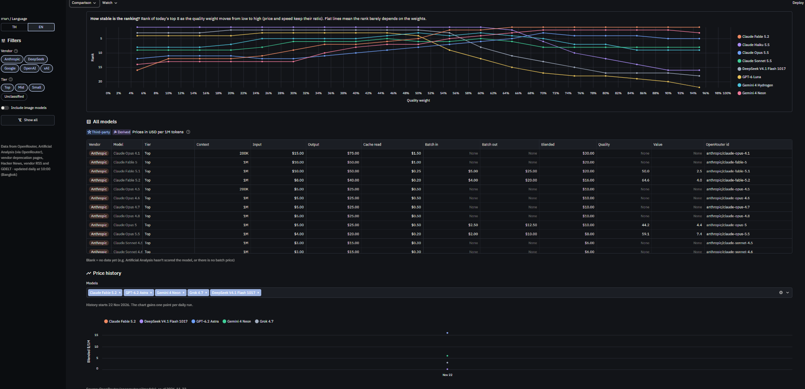 |
| **การใช้งาน** — สรุปอัตโนมัติและตารางรายไตรมาส (ตั้งแต่ ม.ค. 2025) | **การใช้งาน** — สลับเป็นช่วงที่ pipeline เริ่มรัน |
| 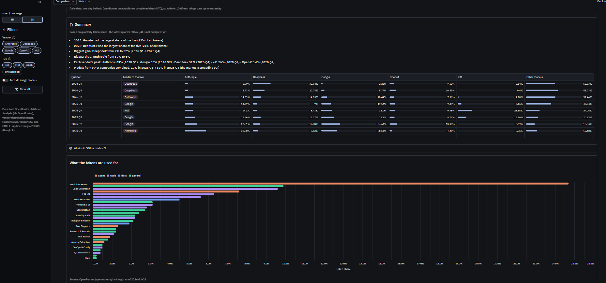 | 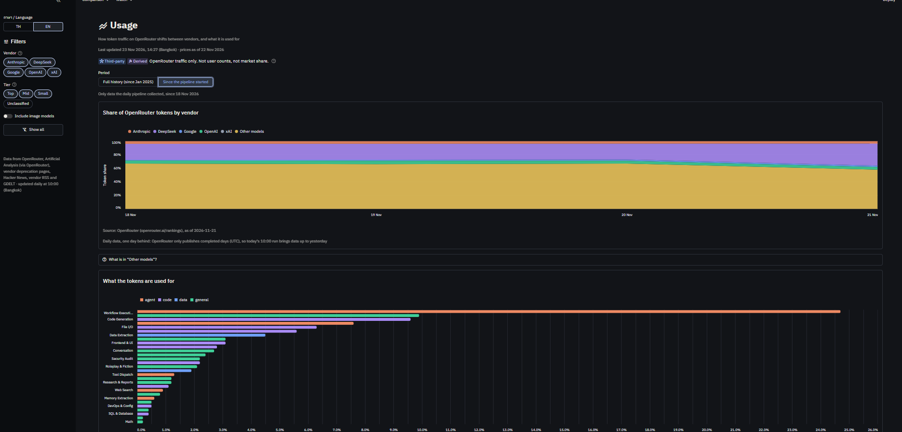 |
| **ข่าวและความเห็น** — คะแนนแต่ละเจ้า, heatmap หัวข้อ, ตัวอย่างความเห็น | **วงจรชีวิตโมเดล** — โมเดลที่ใกล้ปิดใช้งาน |
| 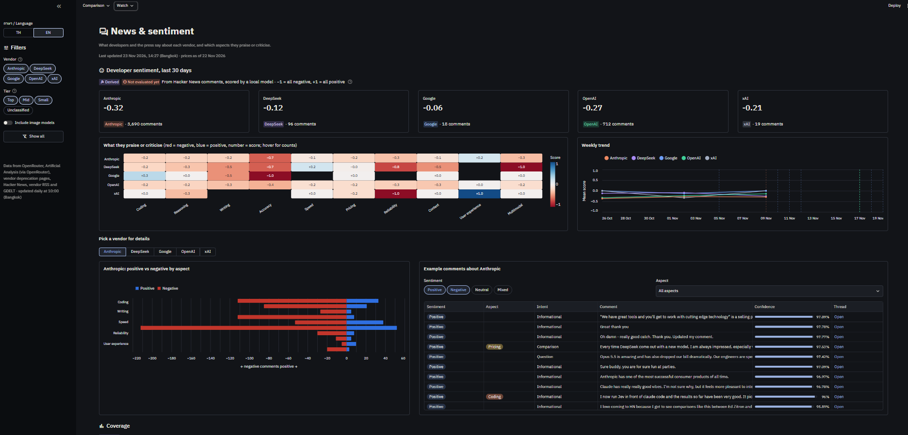 | 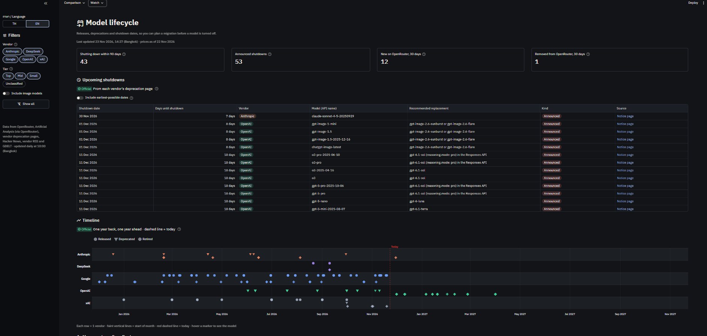 |
| **ไทม์ไลน์** และความเคลื่อนไหวบน OpenRouter | **สถานะ pipeline** — ตารางการรันแบบ Databricks |
| 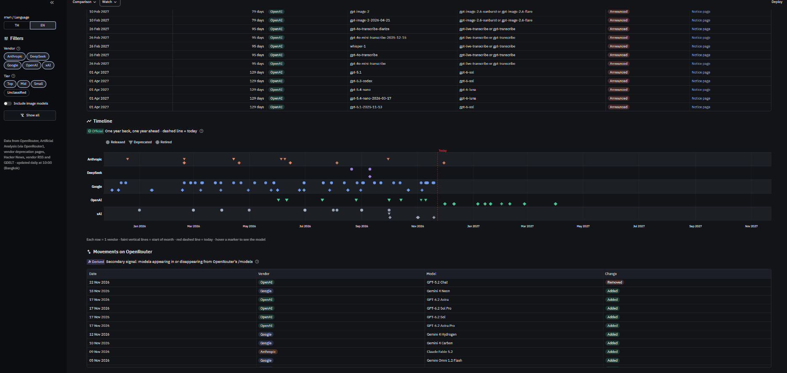 | 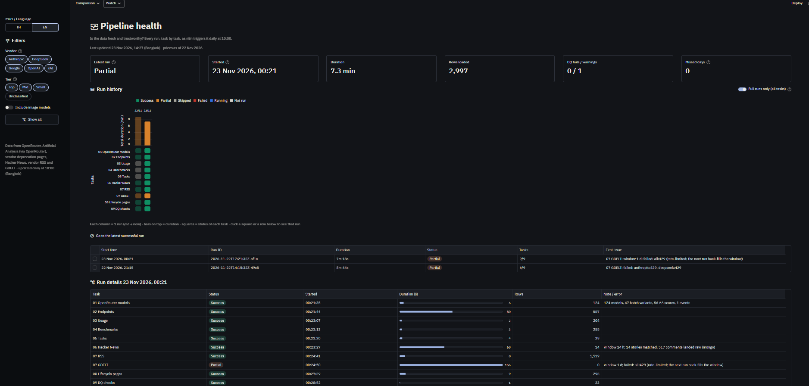 |
| **ข้อมูลทั้งหมดในระบบ** — แยกตามแหล่งและที่เก็บ | **n8n** — workflow `00_master` รายวัน |
| 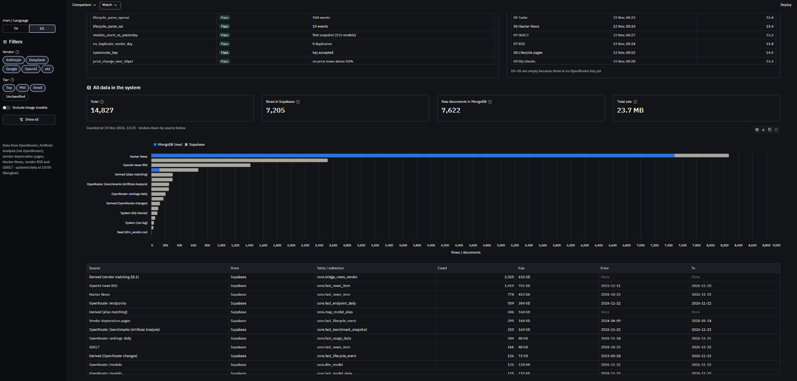 | 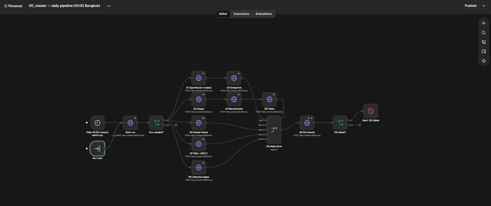 |

---

## สถาปัตยกรรม

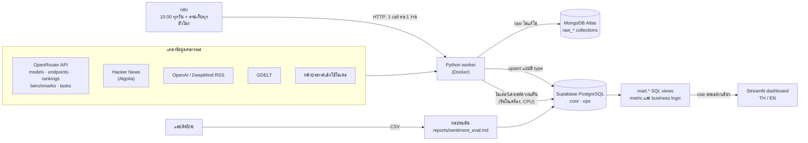

### Workflow รายวันใน n8n

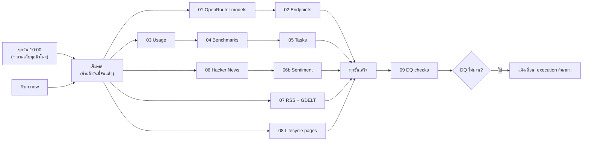

---

## Tech stack

| ชั้น | เทคโนโลยี |
|---|---|
| Orchestration | **n8n** (self-hosted, Docker) — ตั้งเวลา, 1 node ต่อ 1 งาน, retry, แจ้งเตือนเมื่อ DQ ไม่ผ่าน |
| Ingestion และงาน ML | **Python 3.12** worker container (requests, psycopg2, pymongo, **PyTorch CPU + Hugging Face transformers**) ผ่าน HTTP trigger เล็กๆ |
| Raw landing zone | **MongoDB Atlas** (M0 ฟรี) |
| ที่เก็บข้อมูลที่จัดโครงสร้างแล้ว | **Supabase PostgreSQL** — `core` (fact และ dimension), `ops` (log การรัน, DQ, inventory), `mart` (view ที่ dashboard อ่าน) |
| Dashboard | **Streamlit** + **Altair** (Vega-Lite), role ฐานข้อมูลแบบอ่านอย่างเดียว, UI ไทย/อังกฤษ |
| Design | ธีมใน `.streamlit/config.toml` (โทนหมึกบนกระดาษ, ฟอนต์ IBM Plex Sans Thai), สีของแต่ละเจ้าใช้ร่วมกันทั้งกราฟและป้าย |

---

## แหล่งข้อมูล

ทุกแหล่งฟรี ไม่มีการเรียกโมเดลแบบเสียเงินเลย โปรเจกต์นี้ **อ่าน** ข้อมูลสาธารณะเท่านั้น

| แหล่ง | Endpoint | ใช้ทำอะไร |
|---|---|---|
| **OpenRouter** `/models` | `GET https://openrouter.ai/api/v1/models` | รายชื่อโมเดล, context length, modality, ราคา (รวม batch และ cache), คะแนน Artificial Analysis ของแต่ละโมเดล |
| **OpenRouter** `/endpoints` | `GET /api/v1/models/{author}/{slug}/endpoints` | ราคาแยกผู้ให้บริการ, uptime, latency และ throughput (p50–p99) |
| **OpenRouter** rankings-daily | `GET /api/v1/datasets/rankings-daily` | 50 โมเดลที่ใช้ tokens มากที่สุดรายวัน + แถว "other"; ย้อนหลังถึง 2025-01-01 |
| **OpenRouter** `/benchmarks` | `GET /api/v1/benchmarks` | ดัชนี Intelligence / coding / agentic ของ Artificial Analysis |
| **OpenRouter** task classifications | `GET /api/v1/classifications/task?window=7d` | สัดส่วน tokens ตามประเภทงาน |
| **Hacker News** (Algolia) | `GET https://hn.algolia.com/api/v1/search` | กระทู้และความเห็นที่พูดถึงแต่ละเจ้า |
| **OpenAI news RSS** · **Google DeepMind blog RSS** | `openai.com/news/rss.xml`, `deepmind.google/blog/rss.xml` | ประกาศของผู้ให้บริการ |
| **GDELT DOC 2.0** | `GET https://api.gdeltproject.org/api/v2/doc/doc` | ข่าวจากสื่อ (1 query รวมต่อรอบ) |
| **หน้าประกาศเลิกใช้โมเดล** | Anthropic, OpenAI, Google (Gemini API), change log ของ DeepSeek, release notes ของ xAI | วันเปิดตัว เลิกสนับสนุน และปิดใช้งานอย่างเป็นทางการ |
| **โมเดลจาก Hugging Face** | `cardiffnlp/twitter-roberta-base-sentiment-latest` | โมเดลวิเคราะห์ความเห็น รันในเครื่องด้วย CPU |

อ้างอิงที่มา: ข้อมูลการใช้งานและโมเดล — *Source: OpenRouter (openrouter.ai)*; คะแนนคุณภาพ — *Artificial Analysis
ผ่าน OpenRouter* ไอคอนแบรนด์ที่หัวหน้ามาจาก [Lobe Icons](https://github.com/lobehub/lobe-icons) (MIT)
เครื่องหมายการค้ายังเป็นของเจ้าของแต่ละราย

---

## หลักการคำนวณ

| Metric | Logic |
|---|---|
| **ราคาอ้างอิง** | ใช้ endpoint มาตรฐานของผู้ให้บริการเองบน OpenRouter (เช่น `OpenAI [openai]` ไม่ใช่รุ่น `/flex` หรือ `/fast`) → ถ้าไม่มีใช้ค่ามัธยฐานของทุกผู้ให้บริการ → ถ้าไม่มีอีกใช้ราคาหลักของ OpenRouter ไม่ใช้ราคาที่ถูกที่สุด เพราะมักเป็นรุ่นที่บีบอัด (quantised) ถ้าเอาคะแนนของโมเดลเต็มมาหารราคานั้น ความคุ้มค่าจะสูงเกินจริง |
| **ราคาเฉลี่ยถ่วงน้ำหนัก** | `(3 × input + 1 × output) ÷ 4` ดอลลาร์ต่อ 1 ล้าน tokens จากราคาอ้างอิง (งานทั่วไปส่ง input มากกว่า output ราว 3 เท่า) |
| **คุณภาพ** | Artificial Analysis Intelligence Index (รวมผล benchmark มาตรฐาน: ความรู้, การให้เหตุผล, คณิต, โค้ด, การทำตามคำสั่ง) วัดความสามารถอย่างเดียว ไม่รวมความเร็วหรือราคา |
| **ความคุ้มค่า** | `คุณภาพ ÷ ราคาเฉลี่ย` = คะแนนคุณภาพต่อเงิน 1 ดอลลาร์ ค่ากระจายตัวมาก (โมเดลเล็กราคาถูกได้คะแนนสูงมาก) กราฟจึงใช้ log scale |
| **ความเร็ว** | ค่ามัธยฐานข้ามผู้ให้บริการของ throughput p50 (tokens/วินาที) และ latency p50 (มิลลิวินาที) |
| **คะแนนรวม** | `w_q·norm(คุณภาพ) + w_p·norm(1/ราคา) + w_s·norm(ความเร็ว)` ปรับสเกล min-max ภายในตัวกรองปัจจุบัน ผู้ใช้ตั้งน้ำหนักเอง และแสดงคู่กับค่าจริงเสมอ |
| **ส่วนแบ่งการใช้งาน** | tokens ของเจ้านั้น ÷ tokens ทั้งหมดในวันนั้นบน OpenRouter (รวม "other") เป็นแค่ traffic บน OpenRouter ไม่ใช่จำนวนผู้ใช้หรือส่วนแบ่งตลาด โมเดลที่ปิดไปแล้วนับให้เจ้าของตาม prefix ของ OpenRouter |
| **ราคาเปลี่ยน** | ราคาของ endpoint ผู้ให้บริการเองต่างจาก snapshot ก่อนหน้า ถ้าขาดไปบางวัน จะบอกว่าเปลี่ยน "ระหว่างวันที่ A ถึง B" |
| **วงจรชีวิต** | หน้าทางการของผู้ให้บริการเป็นแหล่งหลัก "เห็นครั้งแรก" / "หายจาก OpenRouter" เป็นสัญญาณรองที่คำนวณเอง วันที่แบบ "ไม่เร็วกว่า" / "เร็วที่สุดที่เป็นไปได้" เก็บไว้แต่ติดป้ายว่ายังไม่แน่นอน |
| **ความเห็น** (โมเดล `v0.1`) | ใช้ RoBERTa วิเคราะห์ทั้งความเห็น และแยกแต่ละประโยคย่อยที่พูดถึงหัวข้อ (ตัดที่ *but / however / although*) ดังนั้น "เขียนโค้ดเก่ง แต่แพงไป" จะได้ coding = บวก และ pricing = ลบ ภาพรวม = *ผสม* ถ้ามีทั้งสองแบบ หัวข้อ (10 แบบ) ใช้คลังคำ เจตนา (เปรียบเทียบ, แนะนำ, บ่น, ถาม, ให้ข้อมูล) ใช้กฎ ความเห็นจะนับให้เจ้าไหนก็ต่อเมื่อเอ่ยชื่อเจ้านั้น หรืออยู่ในกระทู้ที่พูดถึงเจ้าเดียว |
| **จับคู่ข่าวกับผู้ให้บริการ** | ต้องมีทั้งคำหลักของเจ้านั้น **และ** คำบริบท (เช่น "Gemini" + Google/AI/LLM) เพราะคำว่า "Gemini", "Claude" และ "GPT" มีความหมายอื่นด้วย |

การประเมินผล: โมเดลวิเคราะห์ความเห็นจะถูกวัดเทียบกับชุดที่ติดป้ายด้วยมือ (`scripts/eval_sentiment.py` →
`reports/sentiment_eval.md`, precision / recall / F1 แยกตาม class และหัวข้อ) ระหว่างที่ยังไม่มีรายงานนี้
dashboard จะแสดงว่าความเห็น **ยังไม่ได้ประเมิน**

---

## สรุป ณ วันที่ 23 พฤศจิกายน 2026

*จากข้อมูลที่เก็บมาจนถึงตอนนี้ (pipeline รันครั้งแรก 22 พ.ย. 2026; ข้อมูลการใช้งานย้อนหลังถึง 1 ม.ค. 2025)*

**ตลาดและโมเดล**
- ติดตามโมเดลข้อความที่ยังใช้งานอยู่ **114** รุ่นจาก 5 เจ้า (OpenAI 58 · Google 20 · Anthropic 16 · DeepSeek 14 · xAI 6) มีคะแนนคุณภาพจาก Artificial Analysis 29 รุ่น
- **คุณภาพสูงสุด:** Claude Fable 5.2 (64.6) · GPT-6.2 Astra (62.1) · Gemini 4 Neon (61.4)
- **คุ้มค่าที่สุด:** Claude Haiku 5.5 (182 คะแนนต่อ $, $0.20 / 1 ล้าน tokens) · GPT-6 Luna (140) · DeepSeek V4.1 Flash 1017 (124)
- **รุ่นท็อปที่ถูกที่สุด:** Claude Sonnet 5 ที่ $4.00 / 1 ล้าน tokens (ราคาเฉลี่ย)
- **เร็วที่สุด (มัธยฐาน throughput p50):** Grok 4.20 Multi-Agent (553 tok/s) · gpt-oss-safeguard-20b (402) · Gemini 2.5 Flash Lite (201)

**วงจรชีวิต**
- **43** model ID มีวันปิดใช้งานทางการภายใน 90 วันข้างหน้า รุ่นแรกคือ `claude-sonnet-4-5-20250929` วันที่ **30 พ.ย. 2026**
- ดึงเหตุการณ์ทางการได้ 295 รายการจากหน้าของ 5 เจ้า และเหตุการณ์ที่คำนวณจาก OpenRouter อีก 126 รายการ

**การใช้งานบน OpenRouter (ม.ค. 2025 → พ.ย. 2026)**
- ผู้นำปี 2025 ใน 5 เจ้า: **Google** (23 % ของ tokens ทั้งหมด); ผู้นำปี 2026: **DeepSeek** (24 %)
- โตมากที่สุด: **DeepSeek** 9 % → 32 % (2025 Q1 → 2026 Q4) ลดลงมากที่สุด: **Anthropic** 39 % → 6 %
- จุดสูงสุด: Anthropic 39 % (2025 Q1) · Google 35 % (2025 Q2) · DeepSeek 32 % (2026 Q4) · xAI 26 % (2025 Q4) · OpenAI 14 % (2025 Q2)
- โมเดลจากบริษัทอื่นรวมกันโตจาก 19 % เป็น 52 % ตลาดกระจายตัวมากขึ้น (สัปดาห์ล่าสุด Tencent เจ้าเดียวมีราว 42 % ของ tokens)

**ข่าวและความเห็น**
- เก็บข่าวได้ 2,463 รายการ (Hacker News 778 · OpenAI news 1,419 · DeepMind blog 100 · GDELT 166)
- วิเคราะห์ความเห็นใน Hacker News **7,317** รายการด้วยโมเดล `v0.1` (25 ต.ค. – 22 พ.ย. 2026) ค่าเฉลี่ย (−1 ถึง +1):
  Google −0.08 (26 ความเห็น) · DeepSeek −0.13 (116) · xAI −0.19 (27) · OpenAI −0.26 (807) · Anthropic −0.33 (6,345)
- หัวข้อที่ถูกติมากที่สุด: **ความแม่นยำ** ของ Anthropic (−0.64, 225 ครั้ง) ตามด้วยความแม่นยำของ OpenAI (−0.41) และความเสถียรของ Anthropic (−0.33)
  หัวข้อที่เป็นบวกมีแค่ **ประสบการณ์ใช้งาน** ของ Anthropic (+0.11) และ **ราคา** ของ DeepSeek (+0.06)
- อ่านตัวเลขนี้อย่างระวัง: โมเดล **ยังไม่ได้ประเมิน**, ความเห็นใน HN มักออกไปทางวิจารณ์อยู่แล้ว และ Anthropic กับ OpenAI
  มีความเห็นรวมกัน 98 % คะแนนของ Google, DeepSeek และ xAI จึงมาจากข้อมูลน้อย

**ข้อมูลที่เก็บไว้**
- ประมาณ **57,700** แถวใน PostgreSQL (รวมข้อมูลการใช้งานรายวัน 35,088 แถว) และ raw document **7,600+** รายการ (~20 MB) ใน MongoDB

---

## วิธีรัน

### สิ่งที่ต้องมี
Docker Desktop, Python 3.11+, MongoDB Atlas M0 cluster, โปรเจกต์ Supabase และ OpenRouter API key แบบฟรี

```bash
cp .env.example .env                       # ใส่ค่าของคุณเอง (ห้าม commit .env)
python -m venv .venv && .venv/Scripts/activate      # Windows; macOS/Linux ใช้ bin/activate
pip install -r worker/requirements.txt -r app/requirements.txt

python scripts/migrate.py                  # สร้าง schema, ตาราง, view และโหลด seed
python scripts/test_keys.py                # ตรวจทุกแหล่งข้อมูลและการเชื่อมต่อ
python scripts/backfill_usage.py           # ไม่บังคับ: ข้อมูลการใช้งานตั้งแต่ 2025-01-01

docker build -f worker/Dockerfile -t ai-model-tracker-worker:local .
docker compose up -d                       # n8n (http://localhost:5678) + worker
docker compose exec n8n n8n import:workflow --input=/workflows/00_master.json
#   จากนั้นเปิด n8n เปิด 00_master แล้วกด activate

python scripts/make_app_secrets.py         # สร้าง credential ของ dashboard (role อ่านอย่างเดียว) จาก .env
cd app && streamlit run streamlit_app.py   # dashboard
```

ติดป้ายและประเมินผล:

```bash
python scripts/export_label_sample.py      # สุ่มตัวอย่าง 300 ความเห็น (ครั้งเดียว)
cd labeler && streamlit run labeler_app.py # แอปติดป้าย
python scripts/eval_sentiment.py           # ประเมิน → reports/sentiment_eval.md
```

---

## โครงสร้าง repository

```
├── app/                   Streamlit dashboard (อ่านอย่างเดียว): streamlit_app.py, app_pages/, lib/, static/brands/
├── labeler/               แอปติดป้าย Streamlit (เขียนแค่ data/labels/)
├── worker/                Python worker: run_daily.py, server.py (HTTP trigger ให้ n8n), jobs/, tracker/
├── n8n/workflows/         00_master.json (export แล้ว ไม่มี credential)
├── supabase/migrations/   SQL migration 001–014 (schema, ตาราง, mart view)
├── mongodb/               init_indexes.js
├── seed/                  dim_vendor.csv, model_tiers.csv
├── scripts/               migrate, test_keys, backfill_usage, export_label_sample, eval_sentiment, …
├── data/labels/           ชุดตัวอย่างสำหรับประเมินและป้ายที่ติดด้วยมือ
├── CLAUDE.md              กติกาโปรเจกต์, data model และนิยาม metric (แหล่งอ้างอิงหลัก)
└── progress.md            สถานะการพัฒนา
```

---

## ข้อจำกัด

- **Snapshot เริ่ม 22 พ.ย. 2026** ราคา คุณภาพ และสถานะวงจรชีวิตดึงได้แค่ "ณ ตอนนี้" จาก API
  ประวัติจึงค่อยๆ เพิ่มวันละวัน มีแค่ข้อมูลการใช้งานที่ดึงย้อนหลังได้
- **การใช้งานเป็นแค่ traffic บน OpenRouter** ไม่ใช่การใช้งานทั้งหมดของแต่ละเจ้า
- **คะแนนคุณภาพ** มีเฉพาะโมเดลที่ Artificial Analysis ทดสอบแล้ว (29 จาก 114 รุ่นในวันนี้)
- **ความเห็นยังไม่ได้ประเมิน** และอิง Hacker News เป็นหลัก ซึ่งพูดถึง Anthropic และ OpenAI มากกว่า Google หรือ xAI มาก
  คะแนนของเจ้าเล็กจึงมาจากความเห็นจำนวนน้อย
- **GDELT** จำกัดจำนวนครั้งตาม IP ถ้าโดนจำกัด รอบถัดไปจะตามเก็บช่วงที่ขาดเอง
